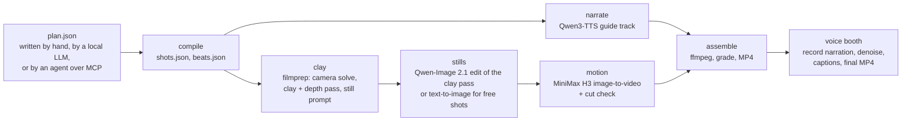

# anubis-clay-film

The local pipeline used to make *Anubis*, a narrated short film adapted from a 634-word prose piece.

Film: https://www.youtube.com/watch?v=TODO

A film starts as a plan: a JSON file listing shots, the narration each shot carries, where people stand, and how the camera is placed. The pipeline builds a metric 3D clay blockout for each shot, turns the blockout into a still with Qwen-Image 2.1, animates each still with MiniMax H3 image-to-video, and assembles the clips under the narration. A separate voice booth records a human narration against the finished picture and burns in captions.

All image, video, speech and caption models run on the local machine through ComfyUI, audio.cpp and Python. The planner can call any OpenAI-compatible endpoint, local or hosted.

## Pipeline



## Hardware it ran on

- 2x NVIDIA RTX 5060 Ti 16 GB (no NVLink; PCIe 3.0 x8 each)
- 32 GB DDR4
- Windows 11

Stills run on a pair of ComfyUI workers, one per card, at about 35 s per 1344x768 still. Motion runs on one ComfyUI process that sees both cards, at about 5 to 6 minutes per 5 s clip. A 38-shot, 4.8-minute film took most of a night to render.

## Layout

| Path | Contents |
|---|---|
| `clay_film/` | Plan schema and validation, planner, stage runner, per-shot versions, cut detector, MCP server. |
| `webui/` | Clay Film Studio, a FastAPI web UI on port 8761 for editing plans and running stages per shot. |
| `voice_booth/` | Voice Booth, a local web app on port 7090 for recording narration against the picture. |
| `filmprep/` | TypeScript clay blockout prep: camera solve, clay and depth renders, still prompts. Includes two example locations. |
| `farm/` | ComfyUI worker farm: worker start/stop, job dispatch, and the ComfyUI graphs for each model. |
| `pipeline_lib/` | Narration, motion and assembly scripts called by the stages. |
| `tts_engine/` | Kokoro narration engine and text preparation used by assembly and narration. |
| `examples/` | An example plan. |
| `marks/` | Proven standing positions per location. |

## Install

1. Python 3.12 or later. Install torch for your CUDA version, then `pip install -r requirements.txt`.
2. Node 20 or later. `cd filmprep && npm install`.
3. ComfyUI with the custom nodes the graphs use (GGUF loader, MiniMax H3 nodes). Set `COMFY_ROOT`.
4. Download the model weights listed below into ComfyUI's model folders. File names are set in `farm/config.py` (`MODELS`).
5. For narration, build audio.cpp and download the Qwen3-TTS GGUF files. Set `AUDIOCPP_CLI`, `QWEN3TTS_BASE_GGUF` and `QWEN3TTS_VOICEDESIGN_GGUF`.
6. Copy `.env.example` and set any paths that differ from the defaults.

`python -m clay_film selftest` checks the schema, locations, cast and planner guide without a GPU.

## Running each stage

```
python -m clay_film guide --location permit-office --seconds 30
python -m clay_film plan NAME --brief "..." --seconds 30 --endpoint http://127.0.0.1:8080/v1 --model local
python -m clay_film new NAME examples/example_plan.json
python -m clay_film run NAME --stages compile,narrate,clay,stills
python -m clay_film run NAME --stages motion
python -m clay_film run NAME --stages assemble
python -m clay_film cuts NAME
python -m clay_film status NAME
python -m clay_film shot NAME still|edit|motion|clay SID [--seed N] [--prompt "..."]
python -m clay_film stop
```

Run motion and assemble as separate steps. The motion stage exits 1 when its frozen-clip gate fires, and locked-off shots trip that gate by design.

The studio runs the same stages from a browser: `python webui/server.py --open`, or `--dry` to fake every GPU job.

The MCP server exposes the same functions to an agent: `python -m clay_film.mcp_server` (stdio).

### Voice booth

`python voice_booth/server.py`, then open http://127.0.0.1:7090. Pick a piece that has been assembled. The page plays the silent picture, optionally with the TTS guide track, and highlights the script as it goes. Takes are recorded twice: an AudioWorklet copy gives the timing and a MediaRecorder copy gives the clean audio, aligned by cross-correlation. The build step lays the chosen takes, applies a spectral-gate denoise and loudness normalisation to -16 LUFS, and muxes them with the picture. Captions use the script text, timed by faster-whisper (small.en, GPU when available), and are burned in by libass in Garamond Bold.

## Plans

A plan has a title, an optional `source` passage, a location, a cast block, and a list of shots. Each shot has a mode: `clay` (blockout, then a Qwen-Image edit of it) or `free` (text-to-image with no blockout). `python -m clay_film guide` prints the full rule set. `examples/example_plan.json` is a valid two-shot plan.

Rules learnt during the *Anubis* render and enforced or documented in the code:

- A shot's `scene` and `subject` must describe only what its still shows. H3 invents a cut to anything named that the still does not contain.
- An `action` must be visible at the still's own scale. Hand-level business on a small full-length figure produces a cut to a close-up.
- H3 renders "X fades" as X appearing. Write the appearance and reverse the clip.
- `clay_film/cutcheck.py` flags a clip whose largest frame-to-frame jump is over 12 and over 6 times its median.

## Models

| Stage | Model | Runs | Licence |
|---|---|---|---|
| Stills (edit and text-to-image) | Qwen-Image 2.1 (int8 ConvRot repack) with a Qwen3-VL 8B text encoder | Local, ComfyUI | Check the Qwen-Image 2.1 model card. Earlier Qwen-Image releases are Apache 2.0. |
| Motion | MiniMax H3 image-to-video (pruned int8 ConvRot repack) | Local, ComfyUI | Check the MiniMax H3 model card and its use restrictions. |
| Guide narration | Qwen3-TTS 1.7B (base clone and VoiceDesign, GGUF via audio.cpp) | Local | Check the Qwen3-TTS model card. |
| Narration engine (optional) | Kokoro-82M | Local | Apache 2.0 |
| Caption and script timing | faster-whisper small.en | Local | MIT (faster-whisper); Whisper weights MIT |
| Planner | Any OpenAI-compatible chat model (tested with Qwen3-14B on llama-server) | Local or hosted | Depends on the model |

No weights are included in this repository.

## Not included

- Model weights, ComfyUI, and generated media.
- The *Anubis* source text and plan, and the narrator reference recording.
- The full location set and story bible of the project the clay locations came from. Two locations and an example bible are included.

## Known limits

- `facing` handles far and near only; left/right yaw has not been checked against a render.
- Close framing in clay mode is not reliably honoured by the still model.
- Multi-location plans compile but have not been rendered end to end.
- The farm scripts (`farm.ps1`, `phase.ps1`) are PowerShell and assume Windows.

## Licence

MIT. See `LICENSE`. Model weights carry their own licences.
