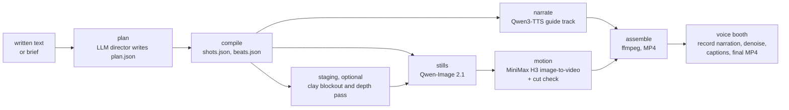

# Scriptorium

Scriptorium is a local pipeline that turns a written text into a narrated film. An LLM directs the text into a shot plan, an image model renders a still for each shot, a video model animates each still, the narration is recorded or synthesised, captions are timed to it, and the parts are assembled into one MP4. Every image, video, speech and caption model runs on the local machine.

> **Early release.** This is the first public version. I will keep updating it and making it more user-friendly. Expect rough edges, Windows-specific scripts and paths tuned to one machine.

The first film made with it is *Anubis*, a narrated short adapted from a 634-word prose piece: https://www.youtube.com/watch?v=TODO

## Pipeline



The `run` command executes the stages in this order: `compile`, `narrate`, `clay`, `stills`, `motion`, `assemble`. Each stage reads what the one before wrote into the piece folder and records itself in `status.json`, so a run can stop at any point and resume with `--stages`.

### 1. Plan

A plan is a JSON file with a title, an optional `source` passage, a style, a cast, and a list of shots. Each shot carries the narration it speaks, what the still shows (`scene`, `subject`), what moves (`action`, `motion`) and how the camera is placed.

`python -m clay_film plan` sends the text or a brief to any OpenAI-compatible chat endpoint (tested with Qwen3-14B on llama-server) together with the rulebook printed by `python -m clay_film guide`. Every answer is checked by `schema.validate`, and the errors go back to the model for up to three repairs. When a `source` passage is given, the narration must cover it verbatim, and the coverage check reports gaps. A plan can also be written by hand, or by an agent through the MCP server (`python -m clay_film.mcp_server`).

### 2. Narrate

Qwen3-TTS 1.7B (GGUF, run through the audio.cpp CLI) reads the narration and produces a guide track and `timeline.json`, which sets each shot's length. This track is a timing guide. The final voice usually comes from the voice booth.

### 3. Stills

Each shot gets one 1344x768 still from Qwen-Image 2.1. A shot has a mode:

- `free`: text-to-image from the shot's `still_prompt`, with the plan's style clause and cast descriptions added. No staging step.
- `clay`: the shot is staged first, then Qwen-Image 2.1 edits the staging image into a photograph.

The clay blockout is one staging aid. `filmprep/` builds a metric 3D blockout of the location, places people at named marks, solves the camera, and writes a clay pass, a depth pass and a still prompt. It is useful when people must stand in specific places in a known set. Two example locations are included (`filmprep/locations/`). The stills graph takes up to ten reference images, so other staging inputs (a sketch, a photograph, an earlier still) can feed the same edit. `python -m clay_film shot NAME edit SID --prompt "..."` edits an existing still with an instruction.

Stills run on two ComfyUI workers, one per GPU, on ports 8190 and 8191.

### 4. Motion

MiniMax H3 image-to-video animates each still into a clip whose length follows the narration. The graph is a copy of ComfyUI's shipped H3 template, run with the 8-step turbo LoRA at 6 steps and Sol-Attn block-sparse attention. It runs on a third ComfyUI worker on port 8192 that sees both GPUs, because the int8 checkpoint is 21 GB.

After rendering, a frozen-clip gate reports clips in which nothing moved, and `clay_film/cutcheck.py` flags a clip whose largest frame-to-frame jump is over 12 and over 6 times its median, which is how an invented cut shows up.

### 5. Assemble

`pipeline_lib/assemble_film.py` lays the clips under the narration with ffmpeg and writes the film.

### 6. Voice booth and captions

`voice_booth/` is a local web app for recording a human narration against the assembled picture. It plays the silent picture, optionally with the TTS guide, and highlights the script as it goes. Each take is captured twice: an AudioWorklet copy gives the timing and a MediaRecorder copy gives the clean audio, and the two are aligned by cross-correlation. The build step lays the chosen takes, applies a spectral-gate denoise and loudness normalisation to -16 LUFS, and muxes the result with the picture.

Captions use the script text. faster-whisper small.en provides word times only, and libass burns the captions in (Garamond Bold by default; the font folder is set by `CAPTION_FONTS_DIR`).

## Hardware

It was built and run on:

- 2x NVIDIA RTX 5060 Ti 16 GB (no NVLink, PCIe 3.0 x8 each)
- 32 GB DDR4
- Windows 11

Stills took about 35 s each per card. Motion took 5 to 6 minutes per 5 s clip. A 38-shot, 4.8-minute film took most of a night. The H3 stage needs a worker that can hold a 21 GB checkpoint across the available VRAM; on a single 16 GB card it will not load as configured.

## Install

Clone the repository, then hand setup to a coding agent:

```
git clone https://github.com/pskeough/scriptorium.git
cd scriptorium
```

Open [`AGENT_SETUP.md`](AGENT_SETUP.md) and give the prompt in it to Claude Code or a similar coding agent running in the repository folder. The prompt has the agent check your GPU and VRAM, install the Python and Node dependencies, find or install ComfyUI and the custom nodes, place the model weights, fill in `.env`, run the self-test and report what is still missing.

The manual steps are the same:

1. Python 3.12 or later. Install torch for your CUDA version, then `pip install -r requirements.txt`.
2. Node 20 or later, then `cd filmprep && npm install` (needed for clay staging only).
3. ComfyUI, with ComfyUI-VideoHelperSuite for the video output node. Set `COMFY_ROOT`. The farm expects ComfyUI's Python at `COMFY_ROOT\venv\Scripts\python.exe`.
4. The model weights listed under Models, placed in ComfyUI's model folders.
5. For guide narration, the audio.cpp CLI and the Qwen3-TTS GGUF files. Set `AUDIOCPP_CLI`, `QWEN3TTS_BASE_GGUF` and `QWEN3TTS_VOICEDESIGN_GGUF`.
6. Copy `.env.example` to `.env` and set any paths that differ from the defaults. The code reads these values from the process environment and does not load `.env` itself, so export them in your shell or set them as user environment variables.

`python -m clay_film selftest` checks the schema, locations, cast, compile step and planner guide without a GPU. `python farm/preflight.py` checks ComfyUI, ports, GPUs, disk and model files before a render, and starts nothing.

## Running

The Python package is still named `clay_film`.

```
python -m clay_film guide --seconds 30
python -m clay_film plan NAME --passage-file text.txt --seconds 30 --endpoint http://127.0.0.1:8080/v1 --model local
python -m clay_film new NAME examples/example_plan.json
python -m clay_film run NAME --stages compile,narrate,clay,stills
python -m clay_film run NAME --stages motion
python -m clay_film run NAME --stages assemble
python -m clay_film cuts NAME
python -m clay_film status NAME
python -m clay_film shot NAME still|edit|motion|clay SID [--seed N] [--prompt "..."]
python -m clay_film versions NAME
python -m clay_film stop
```

Run motion and assemble as separate steps. The motion stage exits 1 when its frozen-clip gate fires, and locked-off shots trip that gate by design.

`CLAY_FILM_DRY=1` fakes every GPU job, so the plan, compile, clay and assembly steps can be tested without models.

Other entry points:

- Studio: `python webui/server.py --open` (port 8761), or `ClayFilmStudio.bat`. Edits plans and runs stages per shot. `--dry` fakes GPU jobs.
- Voice booth: `python voice_booth/server.py`, then open http://127.0.0.1:7090, or `voice_booth/VoiceBooth.bat`.
- MCP server for agents: `python -m clay_film.mcp_server` (stdio).
- Farm: `farm/farm.ps1 start`, `farm/farm.ps1 start -Big`, `farm/farm.ps1 stop`. The stages start and stop the farm themselves.

## Layout

| Path | Contents |
|---|---|
| `clay_film/` | Plan schema and validation, LLM planner, stage runner, per-shot versions, cut detector, MCP server. |
| `farm/` | ComfyUI worker farm: start and stop, job dispatch, graph builders for each model, preflight. |
| `pipeline_lib/` | Narration, motion and assembly scripts called by the stages. |
| `tts_engine/` | Text preparation and the Kokoro narration engine used by narration and assembly. |
| `voice_booth/` | Voice Booth web app and caption builder. |
| `webui/` | The studio, a FastAPI web UI. |
| `filmprep/` | TypeScript clay staging: camera solve, clay and depth passes, still prompts, two example locations, an example story bible. |
| `marks/` | Tested standing positions per location. |
| `examples/` | An example plan. |

## Writing shots

`python -m clay_film guide` prints the full rule set the planner model receives. These rules came from the *Anubis* render:

- A shot's `scene` and `subject` describe only what its still shows. H3 invents a cut to anything named that the still does not contain.
- An `action` must be visible at the still's own scale. Hand-level business on a small full-length figure produces a cut to a close-up.
- H3 renders "X fades" as X appearing. Write the appearance and reverse the clip.

## Models

| Stage | Model | Files (from `farm/config.py` and `farm/graphs.py`) | Licence |
|---|---|---|---|
| Stills | Qwen-Image 2.1, int8 ConvRot repack, Qwen3-VL 8B text encoder | `qwen_image_2.1_int8_convrot.safetensors`, `qwen3vl_8b_w4a8.safetensors`, `qwen_image_2.1_vae_bf16.safetensors` | Check the Qwen-Image 2.1 model card. |
| Motion | MiniMax H3 image-to-video, pruned int8 ConvRot repack, Qwen3-VL 32B text encoder, turbo LoRA | `minimax_h3_fl2va_pruned_int8_convrot.safetensors`, `qwen3vl32b_h3_nvfp4.safetensors`, `minimax_h3_video_vae_fp16.safetensors`, `minimax_h3_fl2v_turbo_8step_v1.0_comfyui_bf16.safetensors` | Check the MiniMax H3 model card and its use restrictions. |
| Guide narration | Qwen3-TTS 1.7B, base and VoiceDesign, GGUF via audio.cpp | `qwen3-tts-12hz-1.7b-base-q8_0.gguf`, `qwen3-tts-voicedesign-q8_0.gguf` | Check the Qwen3-TTS model card. |
| Narration engine (optional) | Kokoro-82M | downloaded by the `kokoro` package | Apache 2.0 |
| Caption timing | faster-whisper small.en | downloaded by `faster-whisper` | MIT |
| Planner | Any OpenAI-compatible chat model | | Depends on the model |

`farm/config.py` also lists Z-Image and Qwen-Image-Edit-2509 files used by older graphs. The current stages do not use them, but `farm/preflight.py` checks every entry in `MODELS` and reports the absent ones.

No weights are included in this repository.

## Not included

- Model weights, ComfyUI and generated media.
- The *Anubis* source text and plan, and the narrator reference recording.
- The full location set and story bible of the project the clay locations came from.

## Known limits

- The farm scripts (`farm.ps1`, `phase.ps1`) are PowerShell and assume Windows.
- Ports, VRAM floors and worker layout in `farm/config.py` are set for two 16 GB cards.
- In clay mode, `facing` handles far and near only, and close framing is not reliably honoured by the still model.
- Multi-location plans compile but have not been rendered end to end.

## Licence

MIT. See `LICENSE`. Model weights carry their own licences.
